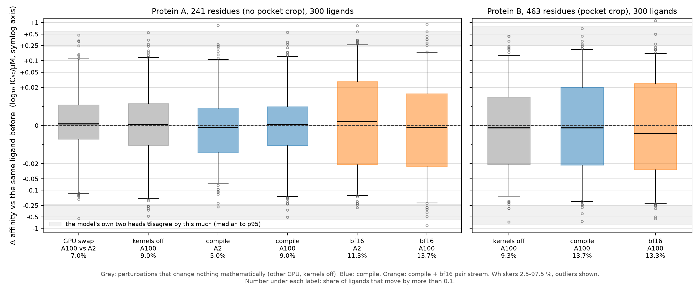

# Inference speed

`nesso predict` compiles the trunk by default; `--fast_trunk` picks the level:

- `compile` (default) compiles each trunk Pairformer layer with `torch.compile`, which fuses
  the elementwise work between the cuEquivariance kernels. It is skipped when the kernels are off.
- `bf16` also carries the pair representation through the trunk in bfloat16. It is opt-in.
- `off` runs the uncompiled model.

This page gives their speed, and what each does to the predictions, measured on an
A2 (15 GB, sm_86) and an A100-PCIE-40GB running the same software (PyTorch 2.14 + CUDA 13,
cuEquivariance 0.11.1, kernels on).

## Speed

Median seconds per prediction after one warm-up, with the tutorial protein truncated to
241 residues (no pocket crop) and in full at 384 residues (pocket crop), six ligands each,
the levels run back to back on an otherwise idle GPU.

| GPU | Residues | `off` | `compile` | `bf16` |
|---|---|---|---|---|
| A2 | 241 | 10.30 | 7.91 (1.3×)† | 6.29 (1.64×) |
| A2 | 384 | 13.44 | 10.91 (1.2×)† | 8.33 (1.61×) |
| A100 | 241 | 1.59 | 1.38 (1.15×) | 1.35 (1.18×) |
| A100 | 384 | 2.08 | 1.76 (1.19×) | 1.66 (1.26×) |

† Measured earlier on an idle A2 with the same code except the contiguous q/k/v change, which adds about 3 %; other jobs
shared the A2 whenever it was repeated, which inflates every level.

Most of the trunk's time is elementwise traffic on the pair representation, so the gain
follows memory bandwidth: the A2 has about an eighth of the A100's. Compiling adds 15–25 s
to the first prediction, which the faster predictions repay after about 6–10 of them on an A2
and 50–120 on an A100; for a single prediction on an A100, pass `--fast_trunk off`. Point
`TORCHINDUCTOR_CACHE_DIR` at persistent storage so later processes reuse the compiled kernels.

## What changes in the predictions

Nesso recycles its trunk, and some ligands sit between two predicted placements. Any change
to the arithmetic, even one that changes nothing mathematically, can send those ligands to the
other placement and move their affinity by a few tenths. So a level cannot be judged by whether
outputs change, only by how much, in which direction, and compared with such a harmless change.

Two harmless changes set the yardstick: running on another GPU model, and turning the
cuEquivariance kernels off. Each level was compared with the same ligands before the change, on
two proteins with 300 ligands each (Δ is in log₁₀(IC₅₀/µM); intervals are 95 % paired bootstrap
over ligands):

- **Protein A**: 241 residues, no pocket crop, predictions spread narrowly (standard deviation 0.25).
- **Protein B**: 463 residues, pocket crop, predictions spread widely (standard deviation 0.88).

**Protein A**

| Comparison | median \|Δ\| | moves by > 0.1 | rank agreement (Spearman) | spread of predictions | mean Δ |
|---|---|---|---|---|---|
| other GPU (A100 vs A2) | 0.009 | 7.0 % | 0.968 | −0.7 % (−3.5, +2.4) | +0.004 |
| kernels off, A100 | 0.011 | 9.0 % | 0.952 | +1.2 % (−4.0, +8.6) | −0.003 |
| `compile`, A2 | 0.012 | 5.0 % | 0.973 | −5.0 % (−11.1, −0.9) | +0.004 |
| `compile`, A100 | 0.010 | 9.0 % | 0.953 | −0.5 % (−3.8, +2.8) | −0.002 |
| `bf16`, A2 | 0.024 | 11.3 % | 0.929 | −7.7 % (−14.0, −2.5) | +0.012 (+0.001, +0.023) |
| `bf16`, A100 | 0.020 | 13.7 % | 0.918 | −3.7 % (−11.0, +3.0) | −0.002 |

**Protein B**, A100

| Comparison | median \|Δ\| | moves by > 0.1 | rank agreement (Spearman) | spread of predictions | mean Δ |
|---|---|---|---|---|---|
| kernels off | 0.020 | 9.3 % | 0.969 | +0.4 % (−0.2, +1.2) | −0.003 |
| `compile` | 0.022 | 13.7 % | 0.964 | −0.1 % (−0.8, +0.7) | −0.001 |
| `bf16` | 0.027 | 13.3 % | 0.966 | +0.2 % (−0.9, +1.2) | −0.007 |

Agreement with measured affinities (300 ligands per protein) does not move beyond what the
harmless changes move it. The change in Spearman against the measurements, relative to before:

| Comparison | Protein A | Protein B |
|---|---|---|
| other GPU | −0.011 (−0.039, +0.016) | not run |
| kernels off | not run | +0.023 (+0.001, +0.047) |
| `compile` | −0.013 (−0.044, +0.020) | +0.021 (−0.002, +0.047) |
| `bf16` | −0.014 (−0.061, +0.031) | +0.010 (−0.014, +0.035) |

The pooled 128-value embedding (`include_embedding`) drifts with `compile` as it does with a
GPU swap on Protein A: median cosine similarity to before 0.999994 against 0.999995, median
relative L2 distance 0.0044 against 0.0042. With `bf16` they are 0.99989 and 0.019.

Reading the tables:

- **Neither level shifts the mean.** The mean Δ stays within 0.012 on both proteins; the one
  interval that excludes zero is `bf16` on the A2 for Protein A, at +0.012.
- **`compile` behaves like a harmless change, with two small exceptions.** On the A100 every
  measure on Protein A matches them, and on Protein B the rank agreement and spread do. The share
  of ligands moving by more than 0.1 on Protein B is 4.3 points above kernels off (+0.3, +8.3).
  On the A2 the spread of Protein A's predictions narrows by 5.0 % (−11.1, −0.9), against −0.5 % on
  the A100 and −0.1 % on Protein B; the difference from a GPU swap is −4.4 points (−11.0, +0.5).
- **`bf16` adds noise that matters when predictions are tightly spread.** On Protein A it lowers
  rank agreement to 0.92–0.93 (0.95–0.97 for the harmless changes), moves more ligands, narrows the
  spread of predictions by 4–8 % (the interval excludes zero on the A2 only), and its embeddings
  drift about 4.5 times further. On Protein B the same level is indistinguishable from `compile`.
  The absolute noise is similar on both proteins (median |Δ| 0.020–0.027), so it is large against
  Protein A's narrow spread of predictions (0.25) and small against Protein B's (0.88).

`compile` is the default. Use `bf16` when throughput matters more than resolving ligands whose
predicted affinities lie close together. `--fast_trunk off` reproduces values from before this
page's changes bit for bit; with `compile` they move as the tables above show.

## Reproducibility

Predictions are bit-identical when the GPU model, the kernels setting and the library versions
all match: the same input reproduced exactly on two A2s five days apart, and the forward-compatibility
`libcuda` used for the A100 runs makes no difference. Across GPU models they are not bit-identical,
as the first rows of the tables show. Pin the whole stack for any batch whose numbers must be
comparable.
